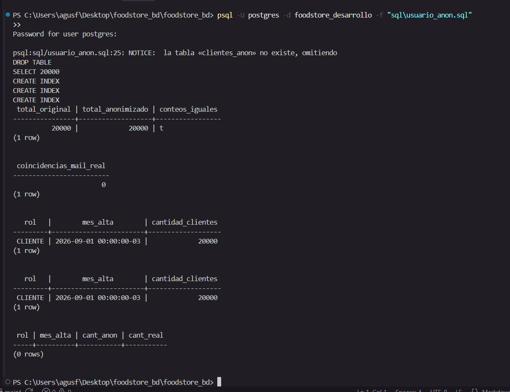

# Verificación de Equivalencia — Parte D
## TP Unidad 5 — Food Store

---

## 1. Objetivo

Demostrar que la anonimización de la tabla `clientes` no distorsiona los
resultados agregados. Los conteos, agrupamientos y distribuciones deben ser
idénticos entre la tabla real y la tabla anonimizada.

---

## 2. Tabla anonimizada: `clientes_anon`

Creada con el script `sql/usuario_anon.sql`. Criterio de anonimización:

| Columna original | Tratamiento | Valor sintético |
|-----------------|-------------|-----------------|
| `nombre` | Reemplazado | `'Cliente' \|\| id` |
| `apellido` | Reemplazado | `'Apellido' \|\| id` |
| `mail` | Reemplazado | `'cliente_' \|\| id \|\| '@anon.example.com'` |
| `celular` | Reemplazado | `'54 11 ' \|\| LPAD(id, 7, '0')` |
| `contrasenia` | Reemplazado | `md5('contrasenia_anonimizada')` (constante) |
| `rol` | Conservado | Igual al original |
| `eliminado` | Conservado | Igual al original |
| `created_at` | Truncado al mes | `DATE_TRUNC('month', created_at)` |
| `updated_at` | Truncado al mes | `DATE_TRUNC('month', updated_at)` |
| `deleted_at` | Truncado al mes | `DATE_TRUNC('month', deleted_at)` |

**Por qué truncar al mes y no eliminar `created_at`:** la columna es necesaria
para los agregados por mes de alta. Truncar al primer día del mes preserva la
granularidad temporal requerida sin exponer la fecha exacta de registro de cada
cliente.

---

## 3. Consultas de agregación comparadas

### Consulta sobre `clientes_anon`

```sql
SELECT
    rol,
    DATE_TRUNC('month', created_at) AS mes_alta,
    COUNT(*)                        AS cantidad_clientes
FROM clientes_anon
WHERE eliminado = FALSE
GROUP BY rol, DATE_TRUNC('month', created_at)
ORDER BY rol, mes_alta;
```

### Consulta equivalente sobre `clientes` (tabla real)

```sql
SELECT
    rol,
    DATE_TRUNC('month', created_at) AS mes_alta,
    COUNT(*)                        AS cantidad_clientes
FROM clientes
WHERE eliminado = FALSE
GROUP BY rol, DATE_TRUNC('month', created_at)
ORDER BY rol, mes_alta;
```

---

## 4. Evidencia de equivalencia

Las capturas de los resultados reales se encuentran en `capturas/logs_tp5_roles/`.

### Resultado sobre `clientes_anon`



`parteD_01_equivalencia_agregados.jpeg` — muestra la salida de la consulta de agregación sobre `clientes_anon` (cantidad de clientes activos por rol y mes de alta) y su equivalente sobre `clientes` real, con la verificación de 0 diferencias.

### Resultado sobre `clientes` (real)

> Ver misma captura — ambas consultas se ejecutaron en la misma sesión de psql y aparecen en la misma pantalla.

### Verificación directa (debe devolver 0 filas)

```sql
-- Esta consulta compara ambos resultados con FULL OUTER JOIN.
-- Si devuelve 0 filas, los agregados son idénticos.
SELECT
    COALESCE(a.rol, b.rol)           AS rol,
    COALESCE(a.mes_alta, b.mes_alta) AS mes_alta,
    a.cantidad_clientes              AS cant_anon,
    b.cantidad_clientes              AS cant_real
FROM (
    SELECT rol, DATE_TRUNC('month', created_at) AS mes_alta, COUNT(*) AS cantidad_clientes
    FROM clientes_anon WHERE eliminado = FALSE
    GROUP BY rol, DATE_TRUNC('month', created_at)
) a
FULL OUTER JOIN (
    SELECT rol, DATE_TRUNC('month', created_at) AS mes_alta, COUNT(*) AS cantidad_clientes
    FROM clientes WHERE eliminado = FALSE
    GROUP BY rol, DATE_TRUNC('month', created_at)
) b ON a.rol = b.rol AND a.mes_alta = b.mes_alta
WHERE a.cantidad_clientes IS DISTINCT FROM b.cantidad_clientes;
-- Resultado esperado: (0 rows)
```

---

## 5. ¿Qué información de Food Store no debería salir nunca hacia una IA sin anonimizar?

La siguiente información concreta de Food Store **nunca debe enviarse a un
asistente de IA** sin pasar antes por un proceso de anonimización equivalente
al aplicado en este trabajo:

- **`clientes.mail` y `clientes.celular`**: son datos de contacto personales
  e identificatorios que permiten ubicar a una persona en el mundo real. Si
  aparecen en un prompt enviado a una IA externa, salen del control de la
  organización y podrían quedar almacenados en los logs del proveedor del
  modelo.

- **`clientes.contrasenia`**: aunque esté hasheada, exponer el hash permite
  ataques de diccionario offline sin necesidad de conectarse a la base. Nunca
  debe salir del servidor.

- **`clientes.nombre` + `clientes.apellido` + `clientes.mail` combinados**:
  individualmente podrían considerarse poco sensibles, pero la combinación de
  los tres constituye un dato personal completo y directamente identificatorio
  bajo cualquier normativa de privacidad (GDPR, Ley 25.326 Argentina).

- **`pedidos` con `cliente_id` sin anonimizar**: los datos de pedidos vinculados
  a un cliente real permiten inferir hábitos de consumo, frecuencia de compra y
  monto gastado — información sensible desde el punto de vista comercial y de
  privacidad.
